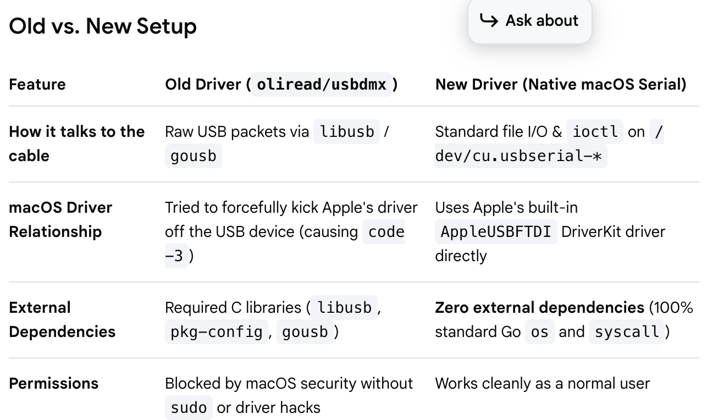

# dmxlights Version 4.0 Release Notes.

# Introduction 

DMX lights is a Open Source Project to control DMX light fixtures. It is designed for the small to medium mobile disco rig or band and be very easy to setup and use.

Firstly we use the Novation Launchpad Mini (Mk3) as the control surface and a cheap FTDI RS422 controller as the interface for the DMX lights.

Second design goal was to do away with having to have a large fixture library, with DMX lights you simply add the description of what channels do what to a simple text file. But in this version we introduce the ability to save and recall these configurations from a text file.

As of versions 4.0 of dmxlights we now support ...

This version of DMX Lights was developed on macOS 10.15.7 (19H2026)

## New in Version 4.0

* Support for the new Fyne threading model in v2.8.2
* Ability to save and restore a fixture config by name
* Throttle Fix to stop overrunning Launchpad
* Replaced the raw libusb USB driver (oliread/usbdmx) with a native macOS serial port implementation that communicates directly through Apple's built-in FTDI Virtual COM Port driver (/dev/cu.usbserial-A50285BI).
Instead of fighting macOS for low-level control of the USB hardware, dmxlights now works with macOS's built-in driver as a high-speed serial port.
* support for hot plugging / auto reconnect for dmx controller interface.
* Bug fix for flash buttons, when in static mode we flash between white and the color of the static scene. Reset now switches off static properly and clears out the off color back to black.
* support for hot plugging / auto reconnect for Novation Launchpad.


 
## Known Problems


# Dependances.

* The fyne toolkit for creating graphical apps for desktop, mobile and web. https://fyne.io/
* Based on fyne.io/fyne/v2 v2.8.2 
* A simple MIDI package for Go. Currently only supports Linux and Mac. https://github.com/scgolang/midi
* Interface to the PortAudio audio I/O library. https://github.com/gordonklaus/portaudio
* PortAudio is a free, cross-platform, open-source, audio I/O library. https://www.portaudio.com/

The Launchpad interface has been inspired by work done by https://github.com/scgolang/launchpad
and https://github.com/rakyll/launchpad.

# Shared Libraries Used

```
 otool -L ./dmxlights
```
